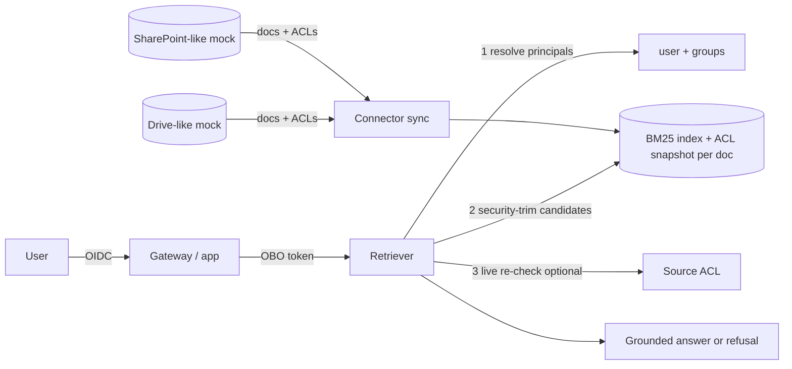

# Permission-Aware RAG (lab)

**Recruiter summary.** RAG systems leak when retrieval ignores who is asking. This lab trims retrieval to each user's document ACLs (folder inheritance, broken inheritance, groups, explicit deny), takes identity only from a signed on-behalf-of token, and measures leakage with a should-not-see eval set generated from the ACL ground truth. It also shows a real failure mode, stale ACL sync, and the live re-check that fixes it. Numbers below are **measured** on a **synthetic** corpus from a real run.

<!-- BEGIN GENERATED -->

**Tests:** 43 passing (`python scripts/count_tests.py`).

**Results** (MEASURED on a SYNTHETIC corpus, 16 docs, 9 users, 144 user-question cases):

| Metric | Value |
|---|---|
| naive: leak rate | 81/92 (88.0%) |
| naive: recall@3 | 18/52 (34.6%) |
| post_filter: leak rate | 0/92 (0.0%) |
| post_filter: recall@3 | 18/52 (34.6%) |
| pre_filter: leak rate | 0/92 (0.0%) |
| pre_filter: recall@3 | 44/52 (84.6%) |
| live_check: leak rate | 0/92 (0.0%) |
| live_check: recall@3 | 44/52 (84.6%) |
| stale ACL (pre_filter): leaks | 2/2 |
| stale ACL (live_check): leaks | 0/2 |
| stale ACL after re-sync (pre_filter): leaks | 0/2 |

<!-- END GENERATED -->

How to read it: *leak rate* = share of should-not-see cases where the forbidden target document reached the model's context. *recall@3* = share of should-see cases where the target was retrieved. Post-filtering is safe but loses recall because restricted near-duplicates fill the top-k; pre-filtering (security trimming before ranking) keeps both. The remaining pre-filter misses are users (such as the CEO) who legitimately see the restricted drafts, which then outrank the public doc.

## Purpose and audience
AI engineers adding enterprise search or copilots on top of SharePoint/Drive-style stores, security reviewers, and trainees. Fictional client: *Harborline Mutual*.

## Architecture


## How it works
1. `corpus.py` defines folders, groups and documents. A doc inherits its folder ACL unless `own_acl` breaks inheritance; `deny` always wins.
2. `acl.py` resolves principals (`user:x` + groups) and issues/verifies an HMAC-signed OBO token with expiry. The retriever reads the user **only** from the token.
3. `index.py` builds BM25 and snapshots each doc's effective ACL at sync time (as real connectors do).
4. `retrieve.py` has four modes: `naive` (bug baseline), `post_filter`, `pre_filter` (recommended), `live_check` (pre-filter plus a query-time check against the source ACL).
5. `evalset.py` crosses 9 users × 16 questions and labels each case should-see/should-not-see from the ACL engine itself.
6. `scripts/run_eval.py` measures leak rate and recall per mode, then changes a folder ACL after sync to measure stale-snapshot leakage.

## Real code and output
```python
retrieve(idx, issue_obo("chen"), "What is the salary band for senior analyst?", "naive")
# -> ['hr-1', ...]   leaked: chen is not in HR
retrieve(idx, issue_obo("guest"), "What was Q3 revenue and margin?", "pre_filter")
# -> []  -> answer(): "I can't find that in documents you have access to."
```

## How to run
```bash
pip install -r requirements-dev.txt
python scripts/run_eval.py && python scripts/count_tests.py
```
No cloud. To adapt to Microsoft 365, replace the mocks with Microsoft Graph / search connectors that return ACLs and use a delegated (OBO) token; for Drive, use the permissions API.

## Guardrails
Identity from signed token only; deny-by-default (unknown users see nothing); explicit deny wins; security trimming before ranking; optional live re-check; refusal when nothing is visible; parametrized no-leak tests for every user and safe mode.

## Limitations and known failures
- **Stale ACLs leak** in `pre_filter` until re-sync (kept as a test). Use `live_check` for sensitive sources or event-driven ACL sync.
- Group membership is resolved at query time here; real systems often cache it.
- BM25 only, 31 synthetic docs: retrieval quality numbers are regression checks, not quality claims.
- Leak rate counts only the target doc; in naive mode other forbidden docs also reach context.
- The "generator" is extractive; an LLM could still combine allowed snippets into an inference (aggregation risk).

## Built vs planned
| Item | Status |
|---|---|
| ACL engine, OBO token, BM25 index, 4 retrieval modes, leakage eval, stale-ACL scenario | Built + tested |
| Microsoft Graph / Drive connectors | Planned |
| Vector index with ACL filter (e.g. Azure AI Search security filters) | Planned |

## Docs
[Implementation guide](docs/implementation-guide.md) · [Training](docs/training.md) · [Interview points](docs/interview-points.md) · [Threat model](docs/threat-model.md) · [ADRs](docs/adr/)

## Related repos
Jagadish-ai-gateway-control-plane (front door), Jagadish-agent-identity-security (OBO patterns), Jagadish-unified-retrieval-router, Jagadish-governed-data-agent.

MIT licensed. Lab code.
